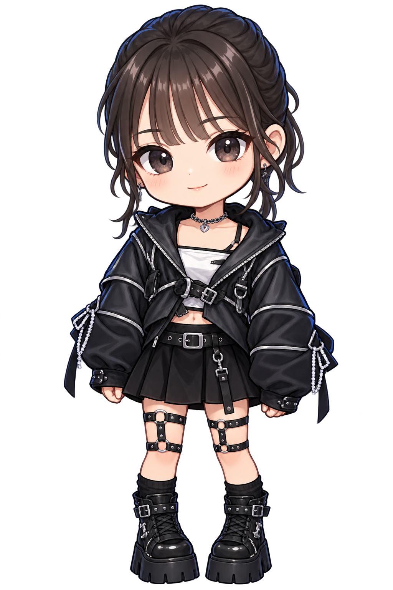

# SARiNAちび素材の分割仕様 — 既存デザイン忠実再現

**状態：素材仕様書。今回の作業では新しいキャラクター画像を制作・変更しない。** `public/assets/chibi/sarina/parts/` にある自動生成PNGはPreview用placeholderであり、SARiNAの完成デザイン・承認済み素材ではない。本番・リリース素材として使用しない。

## 1. 参照元と確定範囲

現在のゲームが実際に参照しているSARiNAの絵は、v0.30の `public/assets/characters/` にある1024×1536 RGBAの全身SD風スプライト5表情である。旧版リポジトリの `sarina_normal.png` 等とv0.30へのコピーは一致している。リポジトリ調査では、独立したSARiNAちび絵、PSD/CLIP等の編集可能なレイヤー原画、別のちびPNGは見つからなかった。したがって本仕様では、次のゲーム内使用画像を唯一の現行参照とする。

| 役割 | 現行ゲーム内の参照 | SHA-256 |
|---|---|---|
| 基本形・体・通常顔 | `public/assets/characters/sarina_normal.png` | `eb1511bb2317931950d6b11978a1c4bcb605d40d1b656a5fc63e8bba051e8e78` |
| 笑顔の顔パーツ | `public/assets/characters/sarina_smile.png` | `3cad75c9916c462c4959e00c31c26cd62082ca8f8843bb9e578ef07c19cecfac` |
| 困り表情の顔パーツ | `public/assets/characters/sarina_troubled.png` | `9a7a980a36b0280c12681015f73ae52894af977dc666d99d0a2f2b708ba47878` |
| 怒りの顔パーツ | `public/assets/characters/sarina_angry.png` | `e1a6d937863c5f246b49f8b391f0fac80fd1e1a786bf41e0f0634b503f101dfd` |
| 泣き表情の顔パーツ | `public/assets/characters/sarina_cry.png` | `0caefd44a35a15e9b8d2c49ad5448aa9837f75f1d1f1f276a922f6144f4443f1` |

`normal`を体の姿勢・輪郭・衣装・通常顔の基準にする。他の表情画像（smile/angry/troubled/cry）は顔パーツの形状参照に限り、各画像に含まれる異なる腕・手・衣装のポーズをnormalの体へ混ぜない。画像はすべて一枚絵であり、隠れた髪・顔・体の部分を復元できる元レイヤーではない。

もしユーザーが想定している基準絵がこの5枚以外の既存ちび絵であれば、制作前にその正確な画像を追加で指定する。完全に元絵どおりの分割を優先する場合は、元のレイヤー付きPSD/CLIP等または透過レイヤー一式を提供する。フラット画像からの切り出しでは、隠れた部分を完全一致で復元できるとは保証しない。

## 2. 変えてはいけないデザイン要素

- **顔・頭身:** 元画像の顔の輪郭、目の大きさと茶色、まぶた・まつ毛、眉、鼻、頬の赤み、口の位置と線を基準にする。丸顔・巨大な頭・短い胴体の新しい汎用ちび比率へ置き換えず、normal画像の全身シルエットと頭身をそのまま保つ。
- **髪:** 元画像の暗い茶〜黒のまとめ髪、頭頂部の毛流れ、中央寄りの前髪、左右の顔脇の長い毛束、後頭部の厚みを保つ。前髪の分け方・毛先・ハイライト・色相を作り直さず、別の髪飾りも追加しない。
- **衣装:** 黒い短丈ジャケット、白いトップス、銀色の縁取り・ジッパー・金具・ベルト類、黒いプリーツスカート、太腿のストラップ、黒い厚底ブーツを同じ形・配色・位置で保持する。ネクタイ、リボン、別の制服、装飾の簡略化はしない。
- **線と塗り:** 元画像の細く柔らかい輪郭線、髪や黒衣装の描き込み、肌・布の陰影、冷色寄りの縁ハイライトを維持する。単色のフラット塗り、太い黒線、別作品の絵柄に描き直さない。
- **緑の担当色:** ゲームデータのSARiNA担当色は `#69e09a` (`src/data/members.ts`)。現在の全身画像には、衣装上の明確な緑のアクセサリーは確認できない。担当色は既存のHOMEカード等のUI表示で維持し、画像に緑のネクタイ・目・ヘアピン等を新設しない。別の既存絵に特定の緑アクセントがある場合は、その絵を追加参照として指定する。

## 3. 512×512置換契約と共通座標

現在の `SarinaChibi` 実装は同名PNG 20枚を512×512の同一キャンバスで重ねる。実装を変えずに差し替える本番素材も、RGBA PNG・512×512・背景透明・共通原点を維持する。ただし元絵は1024×1536（2:3）なので、正方形へ縦横別々に伸縮してはならない。

元絵全体を一様に **1/3** へ縮小すると341⅓×512pxになる。これを512×512キャンバスの水平方向中央に置く（理論上の左余白約85⅓px）。この同じ変換を全レイヤーへ一度だけ適用する。足元中央は元画像座標 `(512,1536)` から出力 `(256,512)` へ対応させ、上下左右に個別のtrim、crop、移動、リサイズを行わない。端数ピクセルは共通の高品質リサンプル規則で処理し、レイヤーごとに丸め方を変えない。

- 出力: 512×512、8-bit RGBA PNG、透明背景。白/黒マットや背景色を焼き込まず、輪郭の半透明アンチエイリアスは保つ。
- 全ファイルを同一キャンバス・同一変換・同一アンカーで書き出し、完成コンポジットの通常姿勢が元の `sarina_normal.png` と同じ体格・位置になることを確認する。
- 現行placeholderの `headCenter: (256,192)` は仮素材の参考値であり、正式絵の頭位置を指定する値ではない。rendererはこの値を参照しない。正式素材の座標は上記の元絵全体変換から決め、顔だけをこのplaceholder値へ無理に合わせない。
- `body`、`arm_left`、`arm_right`、`hair_back`、`head_base`など隣接面は、通常姿勢で継ぎ目・穴・二重輪郭を出さない。動く関節の裏側だけを最小限に補い、表示されない領域に新しい模様や衣装を描き足さない。

## 4. 既存ファイル名ごとの制作指示

ファイル名と `SARINA_CHIBI_PART_ORDER` の奥から手前順は現在のまま維持する。今回の範囲でcomponent、CSS、HOME/STORY組込みは変更しない。

| ファイル | 参照と切り分け |
|---|---|
| `body.png` | `sarina_normal.png`の首下からブーツまで。白トップス、黒ジャケットの前身頃・銀金具、スカート、ストラップ、ブーツを同じ形で保持。腕レイヤーの裏に見える部分だけを補う。 |
| `arm_left.png`, `arm_right.png` | normal画像の左右の袖・手を元の下ろした姿勢のまま切り分ける。袖の白い縁、袖口、金具、手の形を落とさない。大きなポーズ変更を前提に広範囲を新規描画しない。 |
| `hair_back.png` | normal画像の後頭部のまとめ髪と、顔・肩の後ろに来る毛束。前髪や顔前に出る束を混ぜない。 |
| `head_base.png` | normal画像の肌・耳・頬のベース。髪・目・眉・口は別レイヤーにし、元画像の輪郭と頬色を保持する。 |
| `eye_left_open.png`, `eye_right_open.png` | normal画像の左右の開眼を個別に切り出す。瞳色、白目、ハイライト、まつ毛、線の太さを一体で保持する。 |
| `eye_left_closed.png`, `eye_right_closed.png` | smile画像の閉じ目を左右別に使用する。閉じ目のカーブ・まつ毛を新しい記号線に描き変えない。 |
| `brow_normal.png` | normal画像の眉。 |
| `brow_happy.png` | smile画像の眉。 |
| `brow_troubled.png` | troubled画像の眉。 |
| `mouth_smile.png` | normal画像の小さな通常口を基準にする。現行CSSはidleとhappyの双方でこの1枚を使うため、通常顔を常時開口にしない。 |
| `mouth_troubled.png` | troubled画像の困り口を切り出す。形・色・位置を変えない。 |
| `mouth_1.png`〜`mouth_3.png` | talk用。smile/cry画像にある既存の開口を線・色・サイズ・口位置の参照として、同じ絵柄の小さな口形差分を作る。汎用口素材を流用しない。 |
| `hair_front.png` | normal画像の中央寄りの前髪と顔前の毛束。眉・目を隠す位置や束の形を変更しない。 |
| `effect_sweat.png` | troubled画像に実際に描かれている汗のしずくを使う。サイズ・配置は顔の既存表情に合わせる。 |
| `effect_sparkle.png` | 現行5表情に明確なキャラクター用sparkleは確認できない。既存の公式演出素材が別途指定されるまでは完全透明のPNGとし、髪飾り・顔模様として星を描かない。 |

**現行componentの表情枠に関する制約:** `mouth_smile`はidleとhappyに共用される。コードを変えない今回の素材仕様では、通常口をそのままhappyにも使う。`sarina_smile.png`と同じ開いた笑顔をhappy時に完全再現するには、将来 `mouth_happy` 等の追加状態とCSS切替が必要になる。今回はそのコード変更を行わず、別の口を既存スロットへ無理に割り当ててidleの顔を変えない。

## 5. 動きに対する絵の制限

動きは既存の軽いCSS transform・opacityの範囲に留める。通常姿勢の見え方を完成基準とし、頭だけを拡大する、首を伸ばす、髪を大きく揺らす、腕を別ポーズへ変形する、衣装金具を動かすといった新しい演技は作らない。happy/tapの反応は小さな全身弾み、troubledは控えめな縮こまり、talkは口形差分中心にする。`effect_sparkle`が透明ならキラキラを表示しない。これは実装変更ではなく、正式素材の絵を既存デザインに合わせる制限である。

## 6. 参照画像の品質確認事項

このリポジトリ内で確認した全身PNGは、表情によって腕・手のポーズが異なり、すべて一枚絵である。5枚すべての脚周辺または人物背後には赤/黄色の帯・ブロック状画素が見える。これが現行画像の意図した装飾か混入ノイズかはリポジトリだけでは確定できないため、正式パーツに焼き込む/除去する判断を勝手にしない。完成素材へ進む前に原画制作者またはユーザーに確認する。元レイヤーが提供される場合はそちらを優先する。

## 7. 差し替え・承認

placeholder 20枚は削除せず現状のPreview素材として保管する。`manifest.json` は `assetStatus: "placeholder"` / `productionApproved: false` と明記し、生成scriptの成果物を製品素材と誤認しない。正式素材が承認された後、同じ `public/assets/chibi/sarina/parts/` の同名ファイルへ置換すれば、現在のmanifest順、`LayeredChibi`、idle/talk/happy/troubled/tapReaction、HOME/STORY組込みを維持できる。

差し替え時の受け入れ確認:

1. 20 PNGすべてが512×512 RGBA透明で、ファイル名・奥から手前順が実装manifestと一致する。
2. 全レイヤーを通常状態で重ねたシルエット、顔、髪、衣装、頭身、色、線が、変換後の `sarina_normal.png` と同じに見える。レイヤーごとの位置調整、横伸ばし、顔の作り直しがない。
3. 笑顔・困り顔・閉じ目は既存の `sarina_smile.png` / `sarina_troubled.png` の顔部品を参照し、体の別ポーズを混ぜない。
4. 緑の衣装アクセサリーや髪飾り等、新たなデザイン要素を追加しない。チーム色は現在のUIの `#69e09a` を維持する。
5. 元レイヤーが無く、隠れた部分を補う必要があるときは、補完箇所を明示し、完成前にユーザーが通常姿勢の合成プレビューを確認する。
6. 今回は素材制作を実施せず、既存placeholder画像も変更しない。コード・ゲーム進行・セーブへの変更は行わない。
