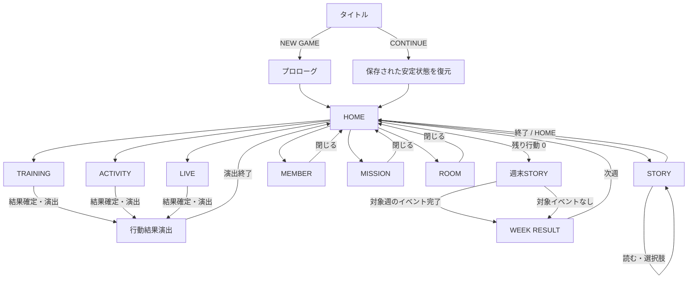

# O-VER-KiLL｜MANAGER’S STORY — v0.30 再構築設計書

**文書の目的**：現行機能・資産・セーブを維持しながら、`game.js → v024.js → v025.js` の後勝ち上書き構造を解消し、全4シーズン32週のコンテンツと機能を安全に追加できる土台を定義する。

**対象リポジトリの基準**：調査時点のHEAD `d719279`。本書は設計のみであり、GitHub上のコードやセーブデータは変更しない。

---

## 0. 設計方針と維持する仕様

### 方針

1. 同名関数の再代入をなくし、各処理の所有者を1か所にする。
2. UI、ゲームルール、ストーリーデータ、永続化を分離する。
3. 週進行・能力計算・ストーリー効果は、画面描画から独立した処理として実装する。
4. 一度確定した行動結果やストーリー効果を、再読込・再表示で二重適用しない。
5. 既存の画像・背景・BGM・シナリオ・演出を可能な限りそのまま再利用する。
6. iPhone Safariの縦画面、タップ操作、保存再開を最優先にする。

### ゲーム仕様の基準値

- 4 SEASON × 8 WEEK = 32 WEEK。週番号はシーズン内で1〜8。
- 各週は自由行動3回、TP 100から開始。
- 行動は、残り行動数とTPの**両方**を満たした場合に実行できる。休養はTP 0でも行動枠を1回使う。
- 1行動の結果演出後はHOMEへ戻る。
- 3行動を使い切ったら、その週の週末ストーリー（存在する場合）を経てWEEK RESULTへ進む。
- STORYの閲覧自体は行動回数・TPを消費しない。
- STORY上の固定成長は、そのイベント効果として一度だけ適用する。読み返しで重複適用しない。
- 能力4種の内部値は1〜700。体力は0〜100でランク対象外。
- MEMBER RANKは能力4種の平均から算出する。

---

# 1. 推奨ファイル構成

現行の静的配信を維持しやすいよう、**Vite + TypeScript + フレームワークなしのSPA**を推奨する。ゲーム規模に対しUIフレームワークは必須ではないが、TypeScriptの型検査、モジュール境界、テスト実行のためにビルド・テスト基盤を導入する。公開物はViteの静的出力とし、サーバー側サービスを必須にしない。

```text
/
├── index.html
├── package.json
├── vite.config.ts
├── tsconfig.json
├── README.md
├── public/
│   └── assets/
│       ├── characters/       # 既存キャラクター画像
│       ├── backgrounds/      # 既存背景画像
│       ├── audio/            # 既存BGM
│       └── ui/               # ロゴ等
├── src/
│   ├── main.ts               # 起動、依存関係の組立て
│   ├── app/
│   │   ├── AppController.ts  # 画面遷移・イベント入口
│   │   ├── routes.ts         # 画面IDと遷移ルール
│   │   └── render.ts         # 現状態を画面へ反映
│   ├── domain/
│   │   ├── types.ts          # GameState、Member、Action等の型
│   │   ├── constants.ts      # 週数、行動数、TP等の定数
│   │   ├── stateFactory.ts   # 新規開始時の初期状態
│   │   ├── selectors.ts      # 表示用の派生値・集計値
│   │   ├── rank.ts           # 能力ランク・MEMBER RANK算出
│   │   ├── progression.ts    # 週開始・行動確定・週末・次週処理
│   │   ├── training.ts       # TRAINING / ACTIVITY / LIVEの計算
│   │   ├── sp.ts             # SP配分・報酬判定
│   │   └── storyEffects.ts   # 固定成長等の一度限りの効果
│   ├── data/
│   │   ├── members.ts        # 4人の初期値・表示情報
│   │   ├── actions.ts        # 活動定義・TP・効果パラメータ
│   │   ├── story/
│   │   │   ├── prologue.ts
│   │   │   ├── season1.ts    # WEEK 1〜8
│   │   │   ├── season2.ts
│   │   │   ├── season3.ts
│   │   │   └── season4.ts
│   │   └── assets.ts         # IDからメディアパスへの対応
│   ├── services/
│   │   ├── SaveRepository.ts # localStorage read/write、検証、世代管理
│   │   ├── migrations.ts     # v0.22〜v0.25 legacy → 新schema
│   │   ├── StoryEngine.ts    # ノード進行、条件評価、イベント確定
│   │   ├── RandomSource.ts   # 成功判定の乱数供給（テスト時はseed固定）
│   │   └── AudioService.ts   # iOSのユーザー操作後にBGM再生
│   ├── screens/
│   │   ├── TitleScreen.ts
│   │   ├── PrologueScreen.ts
│   │   ├── HomeScreen.ts
│   │   ├── StoryScreen.ts
│   │   ├── TrainingScreen.ts
│   │   ├── ActivityScreen.ts
│   │   ├── LiveScreen.ts
│   │   ├── MemberScreen.ts
│   │   ├── MissionScreen.ts
│   │   ├── RoomScreen.ts
│   │   └── WeekResultScreen.ts
│   ├── styles/
│   │   ├── tokens.css        # 色、余白、最小文字サイズ
│   │   ├── base.css
│   │   ├── screens.css
│   │   └── mobile.css        # safe-area、縦横・高さ別調整
│   └── utils/
│       ├── clamp.ts
│       └── format.ts
├── tests/
│   ├── rank.test.ts
│   ├── sp.test.ts
│   ├── progression.test.ts
│   ├── training.test.ts
│   ├── storyConditions.test.ts
│   └── migrations.test.ts
└── scripts/
    └── simulate-balance.ts   # 成長値チューニング用。後続工程で追加
```

### 構成の補足

- `main.ts`は起動・画面登録・各サービスの組み立てだけを行う。ゲーム規則を置かない。
- `domain/`はDOM、`window`、`localStorage`を直接参照しない。入力状態から次状態・結果を返す純粋関数を基本にする。
- `screens/`は表示とユーザー入力を担当し、能力値や週を直接変更しない。入力を`AppController`へイベントとして渡す。
- `data/story/`には週別ストーリーを置く。ストーリーのノードIDは、保存済み途中データとの互換性を考慮して一度公開したら安易に変更しない。
- 既存アセットは当面移動・再圧縮せずパス管理だけ分離し、別工程で配信最適化する。移動する場合は参照切れの自動検査を行う。

---

# 2. 各ファイル・層の責務

| 層 | 責務 | 禁止する責務 |
|---|---|---|
| `screens/` | DOM表示、タップ入力、画面内スクロール | 週数・TP・能力の直接更新、乱数判定 |
| `AppController` | 入力イベントを受け、domain/serviceを呼び、保存と遷移を指示 | 成長値やランク規則の独自実装 |
| `domain/progression.ts` | 週開始、活動回数、週末、次週・次シーズンの状態遷移 | DOM操作、localStorage操作 |
| `domain/training.ts` | 行動の可否、TP・資金・能力・ファン等の計算 | 演出や画面切替 |
| `domain/rank.ts` / `sp.ts` | ランク表示、昇格判定、SP授受・配分 | UI文言・ボタン描画 |
| `StoryEngine` | ノード進行、条件評価、イベント結果の固定、効果の一度限り適用 | 能力の計算式を独自に持つ |
| `data/` | メンバー・行動・ストーリーの宣言データ | グローバル状態への直接変更 |
| `SaveRepository` | 読み込み、schema検証、migration、保存 | 画面やゲームルールの判断 |
| `AudioService` | iOSの再生制約を踏まえたBGM制御 | ゲーム進行への介入 |

**状態変更の原則**：`dispatch(action)`に入力を集約し、domain reducer/serviceが変更後状態と結果イベントを返す。成功した状態変更を保存してから演出を開始する。演出の完了コールバックが同じ行動を再実行する設計にしない。

---

# 3. GameStateの新しいデータ構造

以下は構造案。数値の育成量・成功率など、今回未確定のバランス値は含めない。

```ts
type RankTier = 0 | 1 | 2 | 3 | 4 | 5 | 6; // E, D, C, B, A, S, SS
type ScreenPhase =
  | "title"
  | "prologue"
  | "home"
  | "story"
  | "actionResult"
  | "weekendStory"
  | "weekResult";

type StatName = "vocal" | "dance" | "mc" | "bond";
type MemberId = "sarina" | "miyu" | "kilua" | "raisa";

interface MemberState {
  id: MemberId;
  level: number;
  exp: number;
  stats: Record<StatName, number> & { energy: number };
  sp: number;
  /** SP報酬を付与済み、またはSP昇格により報酬対象外として確定した最高Tier */
  spRewardThroughTier: RankTier;
  /** 演出・履歴表示用。現在値から再計算可能なキャッシュとして扱う */
  rankHistory: Array<{ tier: RankTier; weekKey: string; source: string }>;
}

interface ActionRecord {
  id: string;                // UUID等。一行動の二重適用防止
  weekKey: string;           // 例 "S1W1"
  type: "dance" | "vocal" | "mc" | "sns" | "flyer" | "rest" | "live";
  memberId?: MemberId;       // 全体活動は省略可
  tpCost: number;
  outcome?: "rest" | "super" | "great" | "success" | "normal" | "fail";
  applied: boolean;
  statDelta?: Partial<Record<StatName | "energy", number>>;
  resourceDelta?: { cash?: number; reach?: number; fans?: number };
  createdAt: string;
}

interface GameState {
  schemaVersion: 1;
  gameVersion: "0.30";
  saveId: string;
  createdAt: string;
  updatedAt: string;

  progress: {
    season: 1 | 2 | 3 | 4;
    week: 1 | 2 | 3 | 4 | 5 | 6 | 7 | 8;
    phase: ScreenPhase;
    story: {
      nodeId: string | null;
      eventId: string | null;
      returnPhase: "home" | "weekendStory" | null;
    };
    /** 固定主要イベント・任意イベントごとの初回完了記録 */
    completedEvents: Record<string, boolean>;
  };

  week: {
    actionsUsed: number;       // 0..3
    tpRemaining: number;       // 0..100
    actionHistory: ActionRecord[];
    startedAt: string;
    weekendEventId: string | null;
    resultCommitted: boolean;
  };

  resources: {
    cash: number;
    reach: number;
    fans: number;
    ovkPoints: number;
  };

  members: Record<MemberId, MemberState>;

  /** 週開始時の比較値。週結果表示・ストーリー条件評価に使用 */
  weekStartSnapshot: {
    season: number;
    week: number;
    resources: GameState["resources"];
    members: Record<MemberId, {
      stats: MemberState["stats"];
      level: number;
      exp: number;
    }>;
  } | null;

  /** 一度だけ適用したスクリプト効果のID。読み返し・リロード対策 */
  appliedEffectIds: string[];

  /** 達成・収集・クリア履歴など、周回をまたぐデータ */
  meta: {
    collection: Record<string, boolean>;
    achievements: string[];
    clearHistory: unknown[];
  };

  /** 再開位置。画面表示中の一時データは保存しない */
  ui: { lastStablePhase: ScreenPhase };
}
```

### Stateに含めないもの

- DOM要素、CSSクラス、ローディング進捗、現在のアニメーション状態。
- 乱数ジェネレーターそのもの。結果は行動確定時に`ActionRecord.outcome`へ保存する。
- 派生表示値（残り行動数、平均能力、ランク表示文字列）。`selectors.ts`が計算する。
- タイマーやPromise。ロード後は保存された安定フェーズから再描画する。

### 状態不変条件

- `actionsUsed`は0〜3、`tpRemaining`は0〜100。
- 行動確定前に、行動枠とTP、必要資金を検証する。
- 活動が成功したときだけ`actionsUsed += 1`、TPは定義済みコスト分だけ減る。TP 0の休養も行動枠は消費する。
- `vocal/dance/mc/bond`は1〜700、`energy`は0〜100、EXPは0以上。
- 週を進める操作はWEEK RESULT確定後だけ許可する。
- すべてのストーリー効果・行動結果に一意IDを持たせ、二重適用を拒否する。

---

# 4. 画面遷移図

HOMEをハブとし、Story閲覧が自由行動の消費と結び付かないことを明示する。タイトルと初回プロローグ後はHOMEへ着地する。



### 画面・操作の規則

- `STORY`はいつでもHOMEから開ける。イベントの「既読」と「報酬効果の適用済み」は別々に管理する。
- `TRAINING`、`ACTIVITY`、`LIVE`は同じ行動確定サービスを呼ぶ。ジャンルで処理を分岐しても、行動枠・TP・資金の確認は共通化する。
- `MEMBER`／`MISSION`／`ROOM`をモーダルにするか独立画面にするかはUI実装上選択可能だが、閉じると必ず元のHOMEに戻る。
- 週末イベントの途中で離脱・再読込しても`eventId`・`nodeId`から再開できる。
- 週末STORYを見ただけで行動枠を消費しない。週末ストーリーの固定効果は完了イベントIDに紐付けて一度だけ適用する。

---

# 5. 1 WEEKの進行フロー

1. **週開始**：`season/week`を設定、`actionsUsed=0`、`tpRemaining=100`、行動履歴を初期化。週開始スナップショットを作成する。
2. **HOME**：残り行動・TP・資源・メンバー状態を表示。Storyは行動回数に影響しない。
3. **行動選択**：TRAINING／ACTIVITY／LIVEから種類・対象メンバー等を選ぶ。
4. **事前検証**：行動回数<3、TP残高>=コスト、資金等の条件を検証。不足時は状態変更せず、理由をUIへ返す。
5. **結果の確定**：乱数結果を一度決定し、行動記録を作成。能力・資源・EXP・SP判定・行動回数・TPを一つのdomain処理で更新する。
6. **先に保存**：更新後状態と結果を保存してから演出へ移る。再読込時に乱数再抽選や二重加算をしない。
7. **結果演出**：既存の訓練シーン・成功／失敗表示・能力増加演出を再利用し、終了後HOMEへ戻る。
8. **週の終了判定**：行動3回を使い切った時点で通常行動をロックし、週末ストーリー判定へ移る。Story閲覧やSP配分は行動枠を使わない。
9. **週末STORY**：週定義に固定イベントがあれば再生。育成状態で台詞・差分・演出を選ぶが、主要イベントの存在と基本順序は固定する。
10. **WEEK RESULT**：週開始値との比較、ミッション、成長、資源変化を表示。結果確定フラグを保存する。
11. **次週**：次週または次シーズンの開始処理を行い、週開始スナップショットを作成してHOMEへ。

**二重実行防止**：行動結果確定、ストーリー効果適用、週末結果確定、次週開始の各操作にイベントID／状態ガードを設ける。ボタン連打や画面再表示で同じ処理が二度走らないことをテストする。

---

# 6. STORYと育成結果を接続する仕組み

## 6.1 ストーリーを固定イベントと条件差分に分ける

各週の基本イベントは固定の`eventId`と順番で定義する。条件はイベントを削除・迂回するためでなく、主に会話・反応・演出の差分選択に使う。条件が合わない場合も必ず標準差分を用意する。

```ts
interface StoryEventDefinition {
  id: string;                 // 例 "S1W03_after_training"
  season: number;
  week: number;
  slot: "opening" | "optional" | "weekend";
  required: boolean;          // 主要イベントはtrue
  nodes: StoryNodeDefinition[];
  effects?: StoryEffect[];    // 一度限り。effect.idで冪等化
}

interface StoryVariant {
  id: string;
  priority: number;
  when: StoryCondition[];
  nodeIds: string[];          // 同じイベントの差分台詞・演出
}
```

## 6.2 条件は宣言データとして管理

任意のJavaScript文字列を評価する方式は避ける。条件の種類を限定し、型付きのpredicateとして評価する。

```ts
type StoryCondition =
  | { kind: "statAtLeast"; memberId: MemberId; stat: StatName; value: number }
  | { kind: "memberRankAtLeast"; memberId: MemberId; tier: RankTier }
  | { kind: "teamAverageRankAtLeast"; tier: RankTier }
  | { kind: "memberLeadsBy"; memberId: MemberId; stat: StatName; gap: number }
  | { kind: "bondBelow"; value: number }
  | { kind: "focusedTrainingCountAtLeast"; memberId: MemberId; count: number }
  | { kind: "actionUsedThisWeek"; actionType: string; count: number };
```

- `特定能力がA以上`は内部値501以上に相当するランク境界として判定する。
- `MEMBER RANK`条件はメンバーの総合値から算出したTierを使う。
- `4人平均ランク`は、4人の平均能力を集計してからTier化する等、算定方法を1つに決めて共通selectorに置く。表示と条件で別計算しない。
- `1人だけ突出`は「該当能力が他メンバー最大値を指定差分以上上回る」等、曖昧さのない条件にする。
- `特定メンバーを重点育成`は、週の行動履歴から対象メンバーを指定回数以上選んだかで判定する。能力値の伸びだけから推定しない。

## 6.3 評価タイミングを固定する

イベント開始時に必要な条件入力を`StoryContextSnapshot`として凍結する。イベント途中でSP配分や別画面への移動をしても、同じイベント内で差分が切り替わらないようにする。週末イベントならWEEK RESULT直前の週最終状態を使う。

## 6.4 優先順位とフォールバック

- 条件一致のvariantは`priority`降順で1つ選ぶ。
- 同priorityが複数一致する場合はデータ検証エラーとしてテストで検出する。
- どれも一致しなければ`default` variantを必ず使う。
- 条件分岐は主要イベントの基本的な事実・発生順を変えず、会話や感情、演出を変える。

## 6.5 一度限りの効果

固定成長や報酬は`StoryEffect.id`を`appliedEffectIds`へ記録し、適用済みなら再適用しない。STORYの読み返しは許可しても、成長・資源変化・実績解除は複製されない。

---

# 7. ランク・MEMBER RANK・SP処理の責務

## 7.1 ランク値

能力値`v`（1〜700）のTierと段階は以下で固定する。

```text
index = floor((v - 1) / 100)     // 0〜6
Tier  = [E, D, C, B, A, S, SS][index]
point = v - index * 100          // 1〜100
```

例：1=`E1`、100=`E100`、101=`D1`、200=`D100`、201=`C1`、600=`S100`、601=`SS1`、700=`SS100`。

能力値は1〜700、体力は0〜100で別扱い。体力にTierを付けない。

## 7.2 MEMBER RANK

- `memberRankValue = round((vocal + dance + mc + bond) / 4)`とし、共通関数でTier化する。丸め規則はv0.30の仕様として固定・テストする。
- 例示の`E80, D30, E70, E60`は内部値`80,130,70,60`。平均は85なので、総合は`E85`。
- UI表示、ストーリー条件、SP報酬判定はすべて同じ`rank.ts`を使う。

## 7.3 SP報酬

| 昇格 | SP |
|---|---:|
| E→D | 3 |
| D→C | 4 |
| C→B | 5 |
| B→A | 6 |
| A→S | 8 |
| S→SS | 10 |

### 処理順

1. 成長前の能力・MEMBER RANKを取得。
2. 成長量を適用し、能力を1〜700にclamp。
3. 成長後のMEMBER RANKを算出。
4. 成長ソースを確認（通常レッスン、ストーリー固定成長、LIVE等）。
5. **SP配分による上昇なら**ランク表示を更新し、昇格SPを付与しない。`spRewardThroughTier`も新Tierまで進め、その昇格分が将来再報酬化しないようにする。
6. **報酬対象の通常成長なら**`spRewardThroughTier`を超えたTier分だけSPを加算し、履歴・通知を記録する。
7. 更新後状態と効果イベントを一度だけ保存。

### 禁止事項・例外処理

- SP割当処理から、SP報酬判定関数を呼ばない。
- SP報酬対象の成長ソースを明示し、曖昧な「どの能力変更でも報酬」にはしない。
- 1回で複数Tierを越えた場合、報酬対象成長なら越えた各境界のSPを合計する。
- 読込時にSPを再付与しない。報酬付与の既処理Tierをセーブに保存する。
- 同じ成長イベントIDによる二重報酬を防ぐ。

---

# 8. v024/v025の機能移行手順

| 既存実装 | v0.30への移行先 | 移行時の確認 |
|---|---|---|
| `data.js`のメンバー・初期値・訓練定義 | `data/members.ts`、`data/actions.ts` | IDと能力の意味を維持。数値バランスはシミュレーションまで変更しない |
| `story.js`のプロローグ・Week 1/2ノード | `data/story/prologue.ts`、`season1.ts` | 既存ノードID、主要イベント順、選択肢効果を照合 |
| `game.js`のstate・localStorage | `domain/types.ts`、`stateFactory.ts`、`SaveRepository.ts` | legacy migrationテストを先に作る |
| `game.js`のADV演出・描画 | `StoryScreen.ts`、`StoryEngine.ts` | テキスト速度、画像表示順、選択肢の挙動を維持 |
| `game.js`の週スナップショット・週結果 | `progression.ts`、`WeekResultScreen.ts` | 週開始値と週末値の比較、既存ミッション表示を再現 |
| v024の体力・ランダム成功判定 | `training.ts`、`RandomSource.ts` | 成功率表を移植。乱数結果を行動レコードへ保存 |
| v024のTP・活動回数表示 | `progression.ts`、各画面のselector | TP100と行動3回の独立した制約をテスト |
| v024の訓練結果演出・BGM・プロローグ修正 | `TrainingScreen.ts`、`AudioService.ts`、`PrologueScreen.ts` | 見た目とiOS再生制約を別々に確認 |
| v024の背景参照補正 | `assets.ts` | `manager`等の全参照先が存在することを自動検査。`studio`を含め欠落参照を解消 |
| v025のHOME・遷移 | `HomeScreen.ts`、`AppController.ts` | STORY・訓練後に必ずHOMEへ戻る |
| v025の長期ランク・SP | `rank.ts`、`sp.ts`、`MemberScreen.ts` | 境界値・重複報酬・SP昇格抑止を単体テスト |
| v025のCSS追記 | `styles/` | 旧見た目を比較し、画面単位で再整理。後勝ち依存を解消 |

### 切替方法

1. 現行アプリを稼働させたまま新アプリを別ブランチ／別デプロイURLで構築する。
2. 先に旧セーブを読み込み、新schemaへ変換してHOMEまで復元できる移行プロトタイプを作る。
3. 旧版と新版本体を一時的に並行検証し、既存状態を変えないことを確認する。
4. 移行できないケース用に、旧版へ戻れるデータ保持手順とユーザー向けエラー画面を用意する。
5. 主要画面・セーブ移行・1週完了の受入れ確認後に、本番参照先をv0.30へ切り替える。
6. v024/v025を別scriptとして継続読み込みしない。移行後は新モジュールのみで動かす。

---

# 9. 既存セーブ移行方針

## 9.1 キーとバージョン

- 旧キー：`overkill_manager_v22`。値に`version: "0.22"`、後続パッチにより"0.24"／"0.25"などが含まれる可能性がある。
- 新キー案：`overkill_manager_v030`。JSONの最上位に`schemaVersion: 1`と`gameVersion: "0.30"`を持たせる。
- `gameVersion`はコンテンツ／アプリの版、`schemaVersion`は保存構造の版。両者を混同しない。

## 9.2 起動時の読込順

1. 新キーを読む。存在する場合はschema検証し、必要ならschema migrationを順番に適用する。
2. 新キーがない場合は旧キーを読み、legacy adapterで新構造へ変換する。
3. 変換後状態を検証し、保存できたことを確認してからゲームを開始する。
4. 旧キーは移行成功後も即座に削除・上書きしない。ロールバック用に残す。
5. JSON破損、容量超過、未知schemaの場合は新規ゲームで黙って上書きしない。復旧・エクスポート・旧キー利用の案内を出す。

## 9.3 旧データからのマッピング

- `season/week/node/started/prologueSeen` → `progress`へ移す。ノードIDが現行データに存在するか検査する。
- `actionsUsed` → 0〜3へ検証・補正。
- `trainingTP` → 残TPへ移す。欠損時は週開始セーブなら100、途中データなら安全な補完規則を適用する。推測した値はmigrationログに記録する。
- `reach/fans/cash/ovkPoints` → `resources`へ移す。
- `members`の能力・Lv・EXP・SP → 原則維持し、上限・欠損値だけ補正する。v025セーブのSPを移行時に再初期化しない。
- `weekSnapshot` → `weekStartSnapshot`へ変換。各メンバーのstatsが不足する場合は、結果画面の再表示が安全になるように補完し、移行ログへ記録する。
- `pendingStoryNext` → 対応するstory cursorへ変換。行動結果演出の途中だった場合、既に保存済みの状態を再適用せず、最後の安全な画面へ復帰する。
- `collection/achievements/clearHistory/ovkPoints` → `meta`へ移す。
- `rankBonusClaimed/rankHistory/rankNotices/v025Migrated` → 新メンバー形式へ移す。既存Tier・SP・通知の重複がないよう、現セーブ値を尊重する。
- `appliedEffectIds`は旧セーブに存在しない。既に完了済みの主要イベントは`completedEvents`と週・ノード位置から再適用しない移行規則を定義する。判定不能な履歴を補って報酬を再配布しない。

## 9.4 安全性・互換性

- 移行は`migrateLegacySave()`一か所に集約し、同じ入力から同じ出力になる純粋変換としてテストする。
- 変換した旧セーブのJSONをテストfixtureとして保存し、最低でも「新規直後」「Week 1訓練中」「週末ストーリー中」「Week 2以降」「SP保有」のケースを検証する。
- 既存のlocalStorageはユーザー端末ごとのデータであり、GitHub側のコード変更では直接確認できない。実装前に手元でエクスポートした代表データで試験する。
- localStorage書込み失敗時は画面に知らせ、行動を二重実行させず、最後に保存できた状態を保持する。

---

# 10. 実装順序と受入れ基準

## Phase 1 — 現状固定と基準データ化

- 現行リポジトリのアセット・ノード・訓練データ・選択肢効果を一覧化。
- 現行データを変えずに、既存シーンの期待挙動を「仕様fixture」として記録。
- 既存背景参照などの欠落ファイルを確認し、移行時の参照マップを作成。

**完了条件**：既存シーン・行動・結果画面の対象範囲が一覧化され、欠落参照が特定されている。

## Phase 2 — 型・domainロジック・テスト

- `GameState`、member、action、story event型を定義。
- ランク算定、能力clamp、週進行、活動可否、SP報酬、SP配分を純粋ロジックとして実装。
- 乱数を注入できる`RandomSource`を作り、固定seedで訓練結果を再現可能にする。

**完了条件**：ランク境界値、休養、TP不足、行動枠切れ、複数Tier昇格、SPによるランク境界越えのテストが通る。

## Phase 3 — SaveRepositoryと旧セーブmigration

- 新schemaの保存・検証・書込み失敗時対応を実装。
- 旧キーから新キーへの変換とfixtureテストを実装。
- 旧データを保持したまま移行・復旧できることを確認。

**完了条件**：旧セーブの進行位置・資源・能力・SP・週スナップショットが保持され、読み直しても二重変換・二重報酬が起きない。

## Phase 4 — HOME・ナビゲーション・共通レイアウト

- HOMEを中心に画面遷移を構築。
- STORY閲覧は行動数非消費、活動1回ごとにHOMEへ戻る仕様を実装。
- safe-area、スクロール領域、最低タップサイズ、文字サイズを共通tokensで定義。

**完了条件**：縦向きiPhone相当の幅で主要メニューが見え、スクロール可能で、タップ領域・文字が判読可能。

## Phase 5 — STORYエンジンと既存コンテンツ移植

- 既存プロローグ・Week 1/2のシナリオを移植。
- 固定イベント、条件差分、既読・報酬適用履歴を実装。
- ストーリー条件の優先順位、標準差分、event ID重複を検証する。

**完了条件**：条件による会話差分が再現し、主要イベント順が維持され、読み返しても効果が再適用されない。

## Phase 6 — TRAINING / ACTIVITY / LIVE / MEMBER / RESULT

- 既存のコンディション、ランダム成功判定、演出、BGM、週結果を順次移植。
- 活動枠3回とTP100を同時に管理。
- ランク・SP表示、通知、手動配分を接続。

**完了条件**：各行動が一度だけ反映され、結果演出後にHOMEへ戻り、週末イベントとWEEK RESULTへ進む。

## Phase 7 — 32週データ拡張と育成バランス検証

- Week 1〜32の主要イベント骨格、各週の週末イベントID、ミッション条件をデータ化。
- ストーリー差分条件を各週のevent definitionへ設定。
- 成長量確定前にseed付きモンテカルロシミュレーションを実施する。

### バランスシミュレーション計画

次のプレイ方針を少なくとも複数seedで比較する。

1. 1人に可能な範囲で集中投資。
2. 2人を重点育成。
3. 4人を均等育成。
4. ほぼ育成しないメンバーを残す。
5. 体力低下や失敗を考慮した通常プレイ。

出力は週ごとの個人能力・MEMBER RANK・SP・資源・行動履歴。平均値だけでなく下位／上位分位も見て、偶然の高成功だけで目標を満たしていないか評価する。目標帯はユーザー指定の「集中＝S後半〜SS前半、2人＝A前後、均等＝B前後、低投資＝D後半〜C前後」を参照し、成長量・成功率・固定成長・ライブ成長を調整する。

**完了条件**：各プレイ方針が目標帯におおむね収まり、通常レッスン・ランダム結果・ストーリー固定成長・LIVE成長・SPのどれか一つだけに全体バランスが依存していない。

## Phase 8 — 実機・リリース前確認

- iPhone Safariで新規開始、続きから、画面回転、Safari再読込、低速通信、オフライン復帰、音声再生制約を確認。
- 長い会話／選択肢、週末イベント中の再開、連打、保存失敗、32週完了を確認。
- 画像遅延読み込み・圧縮は、ゲーム内容と移行が安定した後に行う。

**完了条件**：主要フローの操作・保存・復帰でデータ損失や二重進行がなく、iPhone縦画面で主要操作が快適に行える。

---

## 付録A — v0.30で先に固定すべき判断

1. **HOME到着点**：新規開始のプロローグ後はHOMEにする。
2. **週末ストーリーが未定義の週**：イベントなしでWEEK RESULTへ進むか、最低限の共通週末イベントを使うかを決める。推奨は任意イベント扱いで、WEEK RESULTへ進めるフォールバックを必ず持つ。
3. **Story条件のスナップショット**：イベント開始時に固定する。後から値が変わっても同じイベント内の差分を切り替えない。
4. **ランクの平均丸め**：平均を四捨五入してTier化する案を本書で採用。境界値テストを追加する。
5. **SP由来の昇格**：ランク表示は変わるがSPは追加されず、その境界を将来再報酬化しない。
6. **活動メニューの実装順**：TRAININGを先行、ACTIVITY／LIVEを同じ行動基盤へ順次接続。すべてが1行動を消費する。
7. **旧セーブ破損時の対応**：新規ゲームで黙って上書きせず、旧データを残して復旧手段を提示する。

## 付録B — 最低限の自動テストケース

- `E1/E100/D1/SS100`などの能力ランク境界。
- 4能力平均の総合ランクと小数丸め境界。
- 体力が0未満／100超にならず、能力値が1未満／700超にならない。
- TP 35の行動を2回後に残りTPが30で、TP 35行動は拒否される。
- 休養TP 0でも行動回数だけは1消費する。
- 行動3回後に4回目の行動を拒否し、週末フローを開始する。
- STORY閲覧・読み返しで行動数・TPが変化しない。
- 同一`ActionRecord.id`や`StoryEffect.id`を再適用しない。
- SP配分で能力Tierを越えてもSP報酬が発生しない。
- 通常成長で複数Tierを越えた場合のSP付与が定義表どおり。
- 保存→再読込で現在画面・week・node・資源・能力・SPが復元する。
- legacy v0.22／v0.24／v0.25想定データを新schemaへ移行し、元データを破壊しない。
- 週8から次シーズンWeek 1、Season 4 Week 8からゲーム終端／エンディング処理へ正しく移る。
